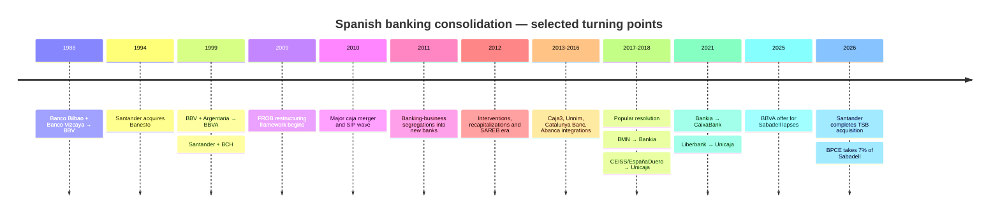
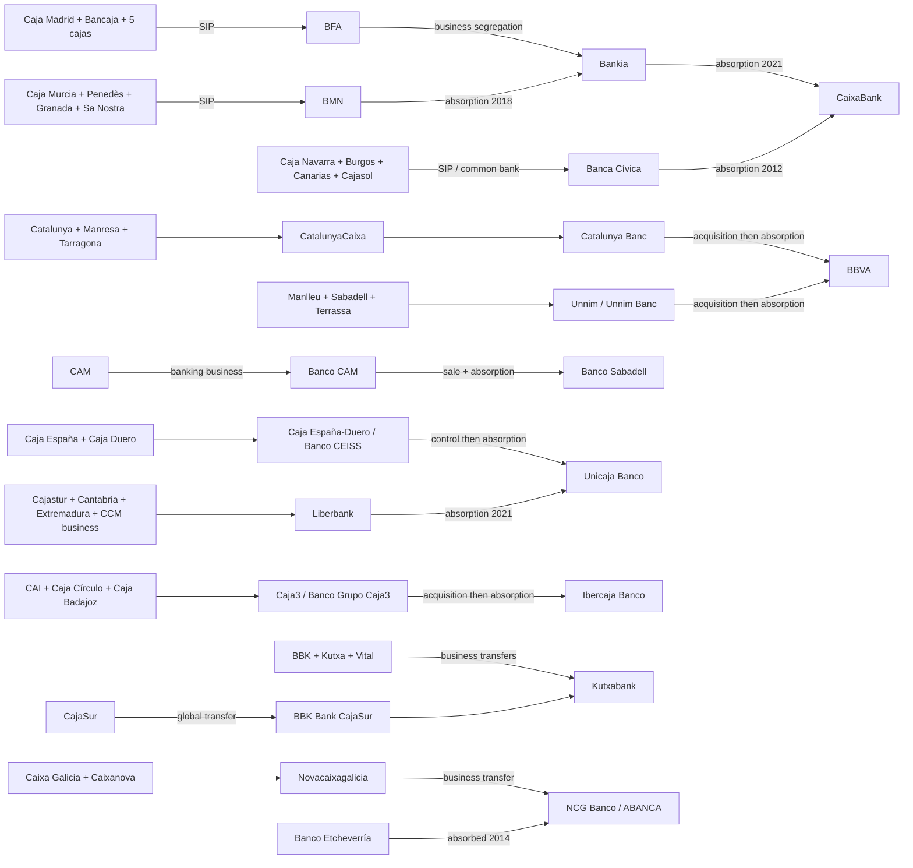

# Spanish Banking Consolidation, 1988–October 2026: Research Foundation, Historical Reconstruction, and Website Data Handoff

## Executive summary and research frame

The attached research brief is present and defines the topic precisely: reconstruct the consolidation of Spain's banking industry from 1988 through **October 27, 2026**, with special emphasis on the restructuring of the *cajas de ahorros* between 2009 and 2012, while preserving distinctions among mergers, SIPs, banking-business transfers, interventions, resolutions, acquisitions, asset transfers, rebrandings, minority stakes, and failed bids. fileciteturn0file0

One important input is **not** present. The attachment says that an initial `banks.json` containing roughly 55–60 entities and 50 relationships will be provided, but the file ends with a placeholder asking for that dataset; no actual starting JSON is attached. fileciteturn0file0 Consequently, this research can reconstruct and validate the history independently, but it **cannot truthfully certify a row-by-row audit of the user's original 55–60 entities or produce a literal “Original Data → Corrected Data” diff**. That is the principal limitation of this deliverable.

The historical conclusion is nevertheless clear. Immediately before the crisis-era restructuring, Spain had **45 savings banks**. The crisis, capital shortfalls, impaired property-related assets, changes in regulation, interventions, and a succession of mergers and business transfers transformed almost the entire caja sector; Banco de España identifies only **Caixa Ontinyent and Colonya–Caixa Pollença** as the two small savings banks that remained in the traditional form. citeturn2search6 The end state was not simply “45 banks became eight banks.” In many cases the original caja survived in a non-banking or foundation-like form after transferring its banking business to a newly created bank, while that bank later changed ownership or was absorbed. The 2021 Banco de España consolidation map graphically confirms the principal lineages and intermediate institutions. citeturn4view0

The verified core dataset produced with this report contains **85 entity records, 51 event/relationship records, and 43 source-registry records**. It deliberately retains nulls and publication flags instead of inventing missing founding dates, legal-effective dates, or geocodes.

[Download the verified-core `banks.json`](sandbox:/mnt/data/banks.json)

[Download the source registry `sources.json`](sandbox:/mnt/data/sources.json)

| Executive finding | Research conclusion |
|---|---|
| **The caja restructuring was primarily a transfer of banking businesses, not simply a wave of legal caja mergers.** | The Bankia case is decisive: seven cajas formed a SIP; their banking businesses were segregated to BFA; BFA then segregated the operating banking business to Altae Banco, renamed Bankia. The cajas and the operating bank therefore cannot be collapsed into a single merger edge. citeturn20search3turn20search16turn20search18turn20search21 |
| **The principal present-day consolidation destinations are historically coherent but reached through very different mechanisms.** | CaixaBank, Santander, BBVA, Sabadell, Unicaja Banco, Ibercaja Banco, Kutxabank and Abanca are the principal destination groups requested in the brief; Banco de España's official map confirms the main predecessor paths. citeturn4view0 |
| **Public restructuring support was large, but “aid granted” must not be equated with final taxpayer loss.** | FROB's figures as of June 30, 2026 distinguish capital/preference/CoCo support, recoveries and guarantees; its table reports €56.545 billion in capital-type assistance including SAREB-related amounts and €7.644 billion of recoveries, while some recovery value remains embedded in BFA's CaixaBank stake. citeturn7search1turn7search6 |
| **CaixaBank became the largest convergence point of the caja-era family trees.** | Its lineage incorporates the la Caixa branch, Banca Cívica, Banco de Valencia, the seven-caja Bankia branch, and—through Bankia—BMN. Bankia itself was legally absorbed by CaixaBank on March 26, 2021. citeturn4view0turn15search6turn15search11 |
| **Resolution is not acquisition-by-merger.** | Banco Popular was declared failing or likely to fail, resolved under the European resolution framework, and transferred to Santander for €1 on June 7, 2017; the later legal absorption of Popular into Santander was a separate 2018 event. citeturn22search0turn22search12turn22search17 |
| **Spanish consolidation was still evolving at the research cutoff, but not every strategic relationship is consolidation.** | BBVA's Sabadell offer lapsed in October 2025 after acceptances representing 25.5% of Sabadell voting rights; BPCE subsequently acquired a confirmed 7.000% Sabadell stake in October 2026. The former is a failed acquisition event and the latter a minority investment, so neither creates a Sabadell lineage edge. citeturn1search4turn1search15 |
| **A separate 2026 transaction matters strategically without changing Sabadell's Spanish-parent lineage.** | Santander reported completion of its acquisition of TSB on May 1, 2026. For this website, that belongs in an international-subsidiary/divestment layer, not as an arrow from Banco Sabadell itself to Santander. citeturn24search8 |

**Research scope and method.** The investigation used the Banco de España consolidation map as the initial topology, then tested consequential edges against transaction-specific Banco de España announcements, BOE/BORME structural-change notices, FROB intervention/restructuring material, SRB resolution material, CNMV filings and bank annual reports or corporate filings. Secondary material such as RTVE's contemporary caja overview was used for chronology and corroboration rather than to determine legal status where an official record was available. citeturn4view0turn3view1turn21search3

The practical implication for the website is fundamental: **the graph must model events, not merely parent-child relationships**. A single historical institution may have a legal-status path, a banking-business continuity path, an ownership path and an asset-transfer path that are not identical.

## Historical reconstruction and legal mechanics

Spain entered the modern consolidation period before the financial crisis. Banco de Bilbao and Banco de Vizcaya agreed their combination in 1988, creating Banco Bilbao Vizcaya; BBV later combined with Argentaria in 1999 to produce present-day BBVA. citeturn24search0turn24search5 Santander acquired Banesto in 1994 and merged with Banco Central Hispano in January 1999; Banesto remained a separate legal banking entity for years before its eventual absorption by Santander in 2013. citeturn24search4turn22search15 This pre-crisis history matters because economic control and later legal extinction can be separated by many years.

The crisis-era transformation was qualitatively different. FROB was created in 2009 as part of the framework for restructuring institutions, and Banco de España oversaw a remarkable number of integrations thereafter. citeturn7search12 The initial response relied heavily on mergers and **Sistemas Institucionales de Protección**, or SIPs, which allowed formerly separate savings banks to coordinate solvency and liquidity and often place their banking business into a common bank without immediately merging the cajas themselves. Banco de España's own contemporary material notes the importance of SIP structures in the 2010 consolidation wave. citeturn2search11turn2search10

Property-related losses and weakened balance sheets were central to the restructuring environment, but consolidation was not solely an exercise in reducing institution counts. Recapitalization requirements and the shift of caja banking businesses into banks materially changed ownership and governance. The February 2011 capital-strengthening framework accelerated this “bankarization” phase. citeturn0search4turn13search11 The November 2012 restructuring decisions for BFA/Bankia, NCG Banco, Catalunya Banc and Banco de Valencia then formed part of the European financial-assistance program. citeturn13search8turn13search19

SAREB must be kept entirely separate in the data model. It was created in November 2012 to receive impaired assets from institutions covered by the restructuring program. An asset transferred to SAREB did **not** mean that SAREB acquired the bank or inherited its banking business. citeturn7search8

The transformation can be divided into four analytically distinct phases:

| Phase | What happened | Representative events | Interpretation |
|---|---|---|---|
| **Pre-crisis consolidation, 1988–2008** | Large commercial-bank combinations and acquisitions built BBVA and Santander and expanded Sabadell. | Bilbao + Vizcaya → BBV in 1988; BBV + Argentaria → BBVA in 1999; Banesto control moved to Santander in 1994. citeturn24search0turn24search4turn24search5 | Mostly strategic M&A among commercial banks rather than crisis resolution. |
| **Caja restructuring, 2009–2012** | Caja mergers, SIPs, banking-business segregations, FROB intervention and recapitalization created Bankia/BFA, BMN, Banca Cívica, Unnim Banc, Catalunya Banc, NCG Banco, Liberbank, Caja3 and other new bank vehicles. citeturn20search3turn20search13turn20search9turn20search1 | This is the period in which a simple “merged with” field becomes most misleading. |
| **Integration and privatization, 2013–2020** | Restructured institutions were acquired, privatized or legally absorbed into larger groups. | Caja3 → Ibercaja; Unnim and Catalunya Banc → BBVA; Banco CAM → Sabadell; NCG Banco → private ownership/Abanca; Popular → resolution → Santander; BMN → Bankia. citeturn19search5turn16search9turn16search0turn23search1turn17search5turn22search0turn14search0 | Ownership acquisition and legal absorption often occurred on different dates. |
| **Large-bank consolidation and strategic repositioning, 2021–2026** | CaixaBank absorbed Bankia; Unicaja absorbed Liberbank; the later BBVA–Sabadell transaction failed; BPCE became a minority Sabadell shareholder; Santander acquired TSB. citeturn15search6turn18search0turn1search4turn1search15turn24search8 | Consolidation continues, but the graph must distinguish completed control transactions from strategic stakes and failed offers. |

A useful high-level timeline is therefore:



The timeline is supported by the official transaction records cited throughout this report. citeturn24search0turn7search12turn15search6turn18search0turn1search4turn1search15

**The controlled transaction taxonomy should be treated as a core piece of the database, not as presentation metadata.**

| Mechanism | Meaning for this project | Graph consequence | Example |
|---|---|---|---|
| **Merger** | Two or more entities legally combine, potentially into a new or surviving entity. | Can create a lineage edge when completed. | Banco Bilbao + Banco Vizcaya → BBV. citeturn24search0 |
| **Absorption** | One legal entity survives and succeeds universally to the absorbed entity's assets and obligations; the absorbed entity is extinguished without liquidation. | Strong lineage edge after legal effectiveness. | Bankia → CaixaBank; Banesto → Santander. citeturn15search20turn22search15 |
| **SIP formation** | Contractual/institutional integration involving mutual support and centralized functions; not necessarily a legal merger of participating cajas. | Preserve participant nodes and connect them to the SIP/central vehicle; do not mark cajas dissolved merely because SIP formed. | Seven-caja Bankia SIP; BMN SIP. citeturn20search3turn20search13 |
| **Banking-business transfer / segregation** | A caja transfers most or all banking operations to a bank while specified non-banking assets or activities can remain behind. | Banking continuity moves; legal-entity continuity may not. | Caja Madrid and Bancaja → BFA; BFA → Bankia. citeturn20search16turn20search18turn20search21 |
| **Acquisition** | Control of shares changes without necessarily extinguishing the acquired entity. | Ownership edge first; later absorption can be a separate event. | BBVA bought 98.4% of Catalunya Banc in April 2015; legal absorption came later. citeturn16search0turn16search4 |
| **Intervention / resolution** | Supervisory or resolution authorities replace management, recapitalize, transfer shares/business or use statutory resolution tools. | Use a distinct resolution edge; do not label as ordinary merger. | Banco Popular in 2017; CajaSur intervention in 2010. citeturn22search0turn20search7 |
| **Asset transfer** | A portfolio of assets moves without corporate control changing. | Never derive `current_group`. | SAREB transfers. citeturn7search8 |
| **Rebranding** | Corporate or commercial identity changes while underlying legal continuity may remain. | Alias/name event, not necessarily lineage. | NCG Banco's evolution into ABANCA requires a name/identity event distinct from the Etcheverría absorption. citeturn17search3turn17search10 |
| **Minority equity investment** | Investor acquires a non-controlling stake. | Ownership event only; never a parent/destination edge absent control. | BPCE's 7.000% Banco Sabadell holding in October 2026. citeturn1search15 |
| **Failed acquisition attempt** | Proposed takeover does not complete. | Timeline event; explicitly excluded from lineage derivation. | BBVA's Sabadell offer, which lapsed in October 2025 after 25.5% acceptance. citeturn1search4 |

The major institutional stakeholders consequently have different roles. Banco de España supervised institutions and approved or documented many integrations; FROB intervened in or restructured problem institutions and managed state ownership; BOE/BORME supplies the strongest evidence for structural legal acts; CNMV records listed-company disclosures; the European Commission governed state-aid and restructuring compatibility; the ECB became central to prudential supervision under the Single Supervisory Mechanism; and the SRB/FROB resolution framework was decisive in Banco Popular. citeturn7search12turn10search0turn22search0

## Family trees, transaction register, and data audit

The most important finding for the website is that the **intermediate entities are not optional**. Removing BFA from Caja Madrid → Bankia, Banco CAM from CAM → Sabadell, Banco Grupo Caja3 from Caja3 → Ibercaja, NCG Banco from Novacaixagalicia → Abanca, or Catalunya Banc from CatalunyaCaixa → BBVA would erase legally meaningful transformations documented in primary records. citeturn20search16turn20search21turn23search1turn19search3turn11search3turn16search4

A compact representation of the core caja-era family trees is:



The Banco de España consolidation map independently confirms these main topology paths, while the individual legal records establish the mechanism and effective sequence. citeturn4view0

**Master entity-register summary.** The machine-readable file contains 85 individual records; the table below gives the principal publication-facing family groups rather than repeating all 85 rows in prose.

| 2026 destination / status | Material historical predecessors in the verified core | Key qualification |
|---|---|---|
| **CaixaBank** | la Caixa; Caixa Girona; Caja Navarra; Caja Burgos; CajaCanarias; Cajasol; Caja Guadalajara; Banca Cívica; Banco de Valencia; Caja Madrid; Bancaja; Caixa Laietana; Caja Insular de Canarias; Caja Ávila; Caja Segovia; Caja Rioja; BFA; Bankia; Caja Murcia; Caixa Penedès; Caja Granada; Sa Nostra; BMN. citeturn4view0 | Several original cajas transferred banking businesses rather than being directly absorbed by CaixaBank. |
| **BBVA** | Banco Bilbao; Banco Vizcaya; BBV; Argentaria; Caixa Catalunya; Manresa; Tarragona; CatalunyaCaixa; Catalunya Banc; Manlleu; Sabadell; Terrassa; Unnim/Unnim Banc. citeturn24search0turn24search5turn4view0 | Catalunya Banc and Unnim were first acquired as controlled subsidiaries and subsequently absorbed. |
| **Santander** | Banco Central Hispano line; Banesto; Banco Popular; Banco Pastor. citeturn24search4turn22search11 | Popular entered Santander by statutory resolution sale in 2017 and was absorbed only in 2018. |
| **Banco Sabadell** | Banco Guipuzcoano; CAM/Banco CAM; Banco Gallego; Banco Urquijo Sabadell and other pre-crisis acquisitions. citeturn23search1turn23search3turn23search4turn23search5 | BBVA did **not** acquire Sabadell in 2025; BPCE is only a 7% shareholder in 2026. |
| **Unicaja Banco** | Unicaja caja line; Caja Jaén; Caja España; Caja Duero; Caja España-Duero; Banco CEISS/EspañaDuero; Cajastur; Caja Cantabria; Caja Extremadura; CCM/Banco Castilla-La Mancha; Liberbank. citeturn18search1turn18search11turn18search0 | The CEISS route and Liberbank route are separate branches that converge in Unicaja. |
| **Ibercaja Banco** | Ibercaja caja; CAI; Caja Círculo; Caja Badajoz; Caja3; Banco Grupo Caja3. citeturn19search5turn19search3 | Ibercaja acquired 100% of Banco Grupo Caja3 in 2013 before the 2014 legal absorption. |
| **Kutxabank** | BBK; Kutxa; Caja Vital; CajaSur/BBK Bank CajaSur. citeturn20search2turn21search6 | BBK, Kutxa and Vital transferred financial business to Kutxabank; CajaSur followed a separate intervention/transfer route. |
| **Abanca** | Caixa Galicia; Caixanova; Novacaixagalicia; NCG Banco; Banco Etcheverría. citeturn20search9turn11search3turn17search3 | Banco Etcheverría was absorbed by the NCG Banco/Abanca legal entity—not vice versa. |
| **Independent traditional cajas** | Caixa Ontinyent; Colonya–Caixa Pollença. citeturn2search6 | Essential counterexample to any statement that every Spanish caja disappeared. |

**High-materiality transaction register.** The downloadable JSON preserves 51 events. These are the events most important to explaining the website's family-tree structure.

| Event | Date / sequence | Mechanism | Status | Primary verification |
|---|---|---|---|---|
| Banco Bilbao + Banco Vizcaya → BBV | 1988 | Merger | Completed | BBVA historical archive. citeturn24search0 |
| BBV + Argentaria → BBVA | Oct. 1999 | Merger | Completed | BBVA archive. citeturn24search5 |
| Santander acquires Banesto | 1994 | Acquisition | Completed | Santander history. citeturn24search4 |
| Santander + BCH | Jan. 1999 | Merger | Completed | Santander history. citeturn24search4 |
| Seven cajas → Bankia SIP/BFA | Jun. 29, 2010 | SIP | Completed | Banco de España. citeturn20search3 |
| Seven cajas → BFA | Mar.–May 2011 | Banking-business segregations | Completed | BORME notices, including Caja Madrid and Bancaja. citeturn20search16turn20search18 |
| BFA → Altae/Bankia | Apr.–May 2011 | Banking-business segregation | Completed | BORME. citeturn20search21 |
| Murcia/Penedès/Granada/Sa Nostra → BMN | Jun. 29, 2010 approval | SIP | Completed | Banco de España. citeturn20search13 |
| Banca Cívica → CaixaBank | 2012 | Absorption | Completed | BORME and Banco de España deregistration. citeturn13search0turn13search4 |
| BMN → Bankia | 2017–Jan. 2018 | Absorption | Completed | BORME/CNMV. citeturn14search0turn14search6 |
| Bankia → CaixaBank | Mar. 26, 2021 | Absorption | Completed | CNMV/BORME. citeturn15search6turn15search20 |
| Catalunya/Manresa/Tarragona → CatalunyaCaixa | Mar. 25, 2010 approval | Merger/integration | Completed | Banco de España. citeturn20search4 |
| Catalunya Banc → BBVA | Award Jul. 2014; closing Apr. 24, 2015 | Acquisition, approximately 98.4% | Completed | BBVA filing. citeturn16search0 |
| Catalunya Banc → BBVA | 2016 | Legal absorption | Completed | BORME. citeturn16search4 |
| Manlleu/Sabadell/Terrassa → Unnim | Mar. 25, 2010 approval | Merger/integration | Completed | Banco de España. citeturn20search1 |
| Unnim Banc → BBVA | Mar.–Jul. 2012 | 100% acquisition for €1 | Completed | BBVA annual accounts. citeturn16search9 |
| Unnim Banc → BBVA | May 23, 2013 registry | Absorption | Completed | BBVA annual accounts. citeturn16search11 |
| CAM + Cajastur + Cantabria + Extremadura SIP | Jun. 29, 2010 | SIP | Ultimately unwound | Banco de España; contemporary chronology. citeturn20search0turn3view1 |
| CAM intervention | Jul. 22, 2011 | Intervention | Completed | Banco de España. citeturn12search11turn12search13 |
| Banco CAM → Sabadell | Jun.–Dec. 2012 | Sale, then absorption | Completed | FROB/BORME/BdE. citeturn12search18turn23search1turn23search10 |
| Banco Guipuzcoano → Sabadell | 2012 legal integration | Absorption | Completed | BORME. citeturn23search5 |
| Banco Gallego → Sabadell | Apr. 8, 2014 deregistration | Absorption | Completed | Banco de España/BOE. citeturn23search2 |
| Caja España + Caja Duero → merged caja | Mar. 2010 approval | Merger | Completed | Banco de España. citeturn20search12 |
| España-Duero business → Banco CEISS | Nov. 2011 onward | Banking-business transfer | Completed | Unicaja institutional history. citeturn18search1 |
| EspañaDuero/CEISS → Unicaja | Sep. 2018 | Absorption | Completed | BORME/Unicaja. citeturn18search4turn18search7 |
| Cajastur/Cantabria/Extremadura → Effibank/Liberbank | 2011 | Business segregations/SIP | Completed | BORME. citeturn20search17turn20search19 |
| Banco Castilla-La Mancha → Liberbank | 2018 | Absorption | Completed | BORME. citeturn18search11 |
| Liberbank → Unicaja | Jul. 30, 2021 | Absorption | Completed | Unicaja. citeturn18search0 |
| Caja3 → Ibercaja Banco | Jul. 25, 2013 | 100% share acquisition | Completed | Ibercaja. citeturn19search5 |
| Banco Grupo Caja3 → Ibercaja Banco | Oct. 2014 | Absorption | Completed | BORME/BdE. citeturn19search3turn19search13 |
| BBK + Kutxa + Vital → Kutxabank | Jan. 1, 2012 operating start | Banking-business transfers | Completed | Kutxabank. citeturn20search6 |
| CajaSur → BBK Bank CajaSur | Jan. 1, 2011 transfer | Intervention/global transfer | Completed | FROB/BOE. citeturn21search3turn21search6 |
| Caixa Galicia + Caixanova → Novacaixagalicia | Jun. 2010 approval | Merger | Completed | Banco de España. citeturn20search9 |
| Novacaixagalicia → NCG Banco | 2011 | Banking-business segregation | Completed | BORME. citeturn11search3 |
| NCG Banco privatization | Dec. 2013 award; 2014 completion process | Share sale | Completed | NCG/Abanca reports 88.33% sold for €1.003bn. citeturn17search5 |
| Banco Etcheverría → NCG Banco/Abanca | Dec. 1, 2014 register exit | Absorption | Completed | BORME/Banco de España. citeturn17search3turn17search10 |
| Popular → Santander | Jun. 7, 2017 | Resolution sale-of-business/share transfer | Completed | SRB. citeturn22search0 |
| Popular → Santander | Sep. 28, 2018 registry | Absorption | Completed | Santander financial reporting. citeturn22search17 |
| Bankia → CaixaBank | Mar. 26, 2021 | Absorption | Completed | CNMV. citeturn15search6 |
| BBVA → Sabadell proposed acquisition | Offer lapsed Oct. 16, 2025 | Failed acquisition attempt | **Not completed** | BBVA/CNMV. citeturn1search4turn0search18 |
| TSB → Santander | May 1, 2026 | Acquisition | Completed | CNMV. citeturn24search8 |
| BPCE → Banco Sabadell | Oct. 2026 | 7% minority investment | Completed as stake only | BPCE/CNMV. citeturn1search3turn1search15 |

**Provisional correction log.** Because the initial JSON is absent, the first column below cannot quote the user's actual records. It instead identifies the shorthand or error that should be corrected if found when the original dataset is eventually compared.

| Entity/event | Shorthand or likely error to reject | Correct representation | Reason and supporting source |
|---|---|---|---|
| Caja Madrid | `Caja Madrid → Bankia` as a direct merger | `Caja Madrid → BFA → Bankia`, both steps involving banking-business segregations within the SIP architecture | BORME separately documents Caja Madrid → BFA and BFA → Altae/Bankia. citeturn20search16turn20search21 |
| Bancaja | `Bancaja merged into Bankia` | Bancaja segregated its banking business to BFA; BFA transferred the operating business to Bankia | Same legal distinction as Caja Madrid. citeturn20search18turn20search21 |
| Banca Cívica | Treating all four cajas as one simultaneous legal merger | Model initial SIP/common-bank structure and Cajasol's later integration separately; then Banca Cívica was absorbed by CaixaBank | Contemporary and legal records show staged formation. citeturn3view1turn13search0 |
| BMN | `BMN → CaixaBank` | `BMN → Bankia → CaixaBank` | Bankia absorbed BMN in 2018; CaixaBank absorbed Bankia in 2021. citeturn14search6turn15search6 |
| Caja España / Caja Duero | Direct `Caja España + Caja Duero → Unicaja` | Merger of cajas → Caja España-Duero → Banco CEISS/EspañaDuero → Unicaja Banco | Unicaja explicitly identifies Banco CEISS as the entity that managed the former cajas' financial business and was absorbed in 2018. citeturn18search1turn18search4 |
| Caja3 | `Caja3 merged into Ibercaja in 2013` | Ibercaja Banco acquired 100% of Banco Grupo Caja3 in July 2013; legal absorption occurred in 2014 | Acquisition and absorption were distinct events. citeturn19search5turn19search3 |
| CAM | Direct `CAM → Sabadell` | Preserve the failed CAM/Cajastur/Cantabria/Extremadura SIP, CAM intervention, Banco CAM vehicle, sale and later absorption | The SIP was approved but broke up; Banco CAM was the entity legally absorbed by Sabadell. citeturn20search0turn23search1 |
| Banco Popular | `Santander bought/merged Popular for €1` as one event | Resolution transferred Popular to Santander for €1 in June 2017; Santander legally absorbed Popular in September 2018 | Resolution and merger were more than a year apart and legally different. citeturn22search0turn22search17 |
| Banesto | `Banesto disappeared into Santander in 1994` | Santander acquired Banesto in 1994; Banesto's legal absorption came in 2013 | Economic control preceded legal extinction by nearly two decades. citeturn24search4turn22search15 |
| Catalunya Banc | Direct `CatalunyaCaixa → BBVA` | `CatalunyaCaixa → Catalunya Banc → BBVA`; BBVA acquired about 98.4% in 2015 and absorbed the bank later | Retaining Catalunya Banc preserves the rescue/privatization phase. citeturn16search0turn16search4 |
| Unnim | `Unnim merged with BBVA in 2012` | Unnim's business was in Unnim Banc; BBVA acquired 100% in July 2012 and the legal absorption was registered in May 2013 | Acquisition and absorption are separate. citeturn16search9turn16search11 |
| NCG / Abanca | `Banco Etcheverría acquired and became NCG` or other directionally ambiguous edge | NCG Banco was privatized to the Banesco/Etcheverría ownership group and subsequently absorbed Banco Etcheverría; the surviving legal bank operated as ABANCA | BORME explicitly names NCG Banco as absorbing company. citeturn17search3turn17search10 |
| BBVA–Sabadell | Completed merger in 2025 | **Failed acquisition attempt**; offer lapsed after 25.5% acceptance | Must remain visible historically but excluded from lineage. citeturn1search4 |
| BPCE–Sabadell | `BPCE → Sabadell` parent relation | **7.000% minority equity investment**, as confirmed in October 2026 | No basis to assign BPCE as Sabadell's current group. citeturn1search15 |
| SAREB | Asset transfers represented as bank acquisitions | `asset_transfer` events only | SAREB received specified impaired assets, not the institutions' banking businesses. citeturn7search8 |

The 2026 BPCE development deserves especially careful treatment. Groupe BPCE announced a friendly strategic investment of around 7% and an intention to explore cooperation and seek board representation, with the possibility of increasing its holding toward 9.9%; by October 15, 2026, CNMV's significant-shareholder data showed BPCE at exactly **7.000%**. Only the completed 7% holding belongs in the canonical facts as of October 27. Future board representation or a larger stake should remain `announced/intended`, not `completed`. citeturn1search3turn1search15

## Quantitative evidence and strategic interpretation

The scale of consolidation is visible in both institutional counts and physical banking infrastructure. Banco de España's historical material records **45 cajas** before the restructuring and only two remaining traditional savings banks afterward. citeturn2search6 Banco de España also reports that the branch network fell from **45,662 branches at end-2008 to 23,340 in June 2020**, approximately a 49% reduction. citeturn5search5 Its earlier analysis put the network at 27,706 branches in 2017, 39% below 2008, while documenting 4,109 municipalities without a bank branch and 1.249 million people—2.7% of the population—living in them. citeturn5search6


The 2023 endpoint of 17,603 branches comes from Funcas rather than the same Banco de España publication, so the visualization should be treated as a **selected-observation trend chart rather than a fully homogeneous regulatory time series**. Funcas reports 17,603 branches in 2023, compared with 45,662 in 2008. citeturn6search10

The employment story is similarly dramatic, although data-source definitions must be kept visible. A Funcas compilation reports employment falling from 270,085 in 2008 to 158,217 in 2022, while the ECB structural series reports **163,864 employees in Spain in 2024**. citeturn6search0turn6search6


Again, the 2024 ECB figure and the earlier Funcas observations should not be silently concatenated into a supposedly exact single statistical series without checking institutional coverage. The chart is therefore useful for scale, not for estimating year-on-year employment growth. citeturn6search0turn6search6

**Publication-worthy statistics**

| Statistic | Date / definition | Interpretation |
|---|---|---|
| **45 cajas** | Pre-crisis savings-bank population | Baseline for the caja restructuring. citeturn2search6 |
| **2 traditional cajas remained** | Post-restructuring: Caixa Ontinyent and Colonya–Caixa Pollença | Nearly the entire traditional caja sector changed form or banking-business destination. citeturn2search6 |
| **45,662 branches** | End-2008 | Peak-era physical network baseline. citeturn5search5 |
| **27,706 branches** | 2017 | 39% below 2008. citeturn5search6 |
| **23,340 branches** | June 2020 | Approximately 49% below end-2008. citeturn5search5 |
| **17,603 branches** | 2023, Funcas compilation | Further network rationalization after the crisis restructurings. citeturn6search10 |
| **4,109 municipalities without a branch** | 2017 | Geographic-access consequence of network retrenchment. citeturn5search6 |
| **1.249 million people / 2.7% of population** | 2017 | Population living in municipalities without a bank office. citeturn5search6 |
| **270,085 employees** | 2008, Funcas compilation | Pre-consolidation employment baseline. citeturn6search0 |
| **158,217 employees** | 2022, same secondary compilation | Illustrates the scale of workforce rationalization. citeturn6search0 |
| **163,864 employees** | 2024, ECB structural indicator | More recent official structural observation; category alignment with the Funcas series should be checked before calculating growth. citeturn6search6 |
| **€56.545bn** | FROB capital/preference/CoCo-type assistance including the stated SAREB component, position at June 30, 2026 | Gross assistance measure, **not a final taxpayer-loss figure**. citeturn7search1 |
| **€7.644bn recovered** | FROB table, June 30, 2026 | Recovery recorded against assistance; further Bankia/CaixaBank value remains relevant. citeturn7search1 |
| **€2.055bn final cost of EPAs/guarantees** | FROB position at June 30, 2026 | Much smaller than the original maximum guarantee exposure; separate from capital aid. citeturn7search1 |
| **€22.424bn BFA/Bankia capital support** | FROB assistance table | Largest named capital-support line in the restructuring table. citeturn7search1 |
| **€12.052bn Catalunya Banc support** | FROB table | Illustrates the fiscal scale of Catalunya Banc's restructuring before privatization. citeturn7search1 |
| **€9.052bn NCG Banco support** | FROB table | Relevant context for the later €1.003bn privatization to the Banesco/Etcheverría group. citeturn7search1turn17search5 |
| **18.1% CaixaBank stake held through BFA** | End-2025 FROB position | The public-sector recovery story did not end with the 2021 merger. FROB reported a €15.467bn value for the stake at end-2025 and €1.722bn in dividends recovered through BFA. citeturn7search6turn11search6 |
| **€623.8bn total assets, nearly 20m customers** | CaixaBank immediately after Bankia legal merger, March 2021 | Shows the scale created by the largest caja-family convergence. CaixaBank also stated 26% and 24% market shares in loans and deposits respectively at the time. citeturn15search11 |
| **≈€113bn assets and >4.5m customers** | Unicaja after Liberbank merger, July 2021 | The combination created what Unicaja described as Spain's fifth-largest bank at the time. citeturn18search0 |
| **0.1296 HHI** | Spain, 2024 ECB structural indicator | A useful official concentration measure; it should be compared through time rather than translated mechanically from the number of entities in this curated database. citeturn8search4 |
| **25.5% acceptance** | BBVA offer for Sabadell, Oct. 2025 | Why the transaction belongs under failed bids rather than consolidation lineage. citeturn1search4 |
| **7.000% BPCE stake** | CNMV significant-shareholder record, Oct. 15, 2026 | Strategic minority ownership, not control. citeturn1search15 |

The FROB figures should be presented especially carefully. Adding gross capital injections, guarantees and later market values into a single “bailout cost” number would be misleading because the categories have different economic meanings, recoveries have occurred, and the state still held a material CaixaBank interest through BFA at end-2025. citeturn7search1turn7search6

**What consolidation says about banking economics.** The strongest evidence is that merger **form** matters. A Banco de España research paper comparing conventional mergers/acquisitions with SIPs in the 2009–2011 caja restructuring finds materially different effects on credit provision, pricing, non-performing loans and efficiency; its welfare analysis attributes an important role to longer-run cost-efficiency gains. This is a strong warning against treating “fewer banks” as the explanatory variable by itself. citeturn0search3

Management rationales for later transactions also emphasize scale and fixed-cost economics. When Unicaja and Liberbank announced their planned combination, they explicitly cited persistent low interest rates, industry transformation and digitalization and projected roughly €192 million of recurring annual cost savings once fully realized. citeturn18search9 CaixaBank similarly described the Bankia combination in terms of stronger scale, profitability and the need to adapt to technological disruption and a changed macroeconomic environment. citeturn15search17turn15search11 Those statements establish the strategic rationale advanced by the participants; they do **not**, by themselves, prove that every increase in bank size raises social welfare or customer outcomes.

The post-crisis regulatory environment also changed the feasible strategies. Centralized European supervision under the Single Supervisory Mechanism makes capital, governance and resolvability constraints increasingly European rather than purely national; Banco Popular's 2017 case demonstrates the practical importance of the Single Resolution Mechanism and sale-of-business tools. citeturn10search0turn22search0

For competition analysis, the website should resist a tempting but invalid shortcut: **do not calculate concentration from the number of nodes remaining in the family-tree dataset**. Market concentration must use consistent banking-sector denominators—assets, deposits, lending or local market shares—and competition for SMEs can differ substantially by province from national concentration. The ECB's structural indicators, Banco de España banking statistics, and transaction-specific competition decisions are more defensible inputs than an institution count. citeturn8search2turn8search4

The forward-looking conclusion is therefore scenario-based rather than a prediction of a specific merger. Scale pressures from technology, compliance, capital and platform investment can encourage combinations, while concentration constraints, integration risk, political/regional sensitivities and the ability of well-capitalized specialists to differentiate can restrain further domestic combinations. The 2025–2026 Sabadell sequence is itself evidence that strategic pressure does not automatically produce a merger: the BBVA offer failed, while BPCE's later move remained a minority investment. citeturn1search4turn1search3

AI should be treated as a **research hypothesis**, not as an established historical driver of this consolidation cycle. Large fixed investments in models, data infrastructure and compliance could reinforce scale economies, while cloud services and specialist vendors could simultaneously lower the technology threshold for smaller institutions. The historical dataset cannot determine which force will dominate; the website should therefore avoid presenting AI as evidence for an inevitable next merger wave.

## Website dataset, visualization, and editorial handoff

The recommended architecture is an **event-sourced static graph**, not a table in which each old bank simply has a single `merged_into` field. The canonical entity represents an institution; each relationship represents a dated event with a controlled mechanism and completion status; source records are stored separately and referenced by ID. This allows the front end to reconstruct lineage without confusing ownership, legal extinction and banking-business continuity.

A publication-oriented entity should use fields along these lines:

```json
{
  "id": "caja-madrid",
  "name": "Caja de Ahorros y Monte de Piedad de Madrid",
  "aliases": ["Caja Madrid"],
  "type": "caja",
  "founded": 1702,
  "headquarters_city": "Madrid",
  "autonomous_community": "Comunidad de Madrid",
  "status": "historical_nonbanking_successor_possible",
  "current_group": "caixabank",
  "publication_ready": true,
  "sources": ["source-id"],
  "notes": "Banking business moved through BFA and Bankia."
}
```

For Caja Madrid, `current_group: "caixabank"` means **current destination of the historic banking business**; it must not imply that the original caja legal person was directly absorbed by CaixaBank. The BORME segregation documents are explicit that specified brands, social-work assets, *monte de piedad* activities and other excluded items remained outside the transferred banking patrimony. citeturn20search16

The event object should preserve that distinction:

```json
{
  "id": "evt-caja-madrid-bfa-2011",
  "from": ["caja-madrid"],
  "to": "bfa",
  "announcement_date": null,
  "effective_date": "2011-05-23",
  "mechanism": "banking_business_transfer",
  "status": "completed",
  "ownership_percentage": null,
  "sources": ["source-boe-caja-madrid-bfa"],
  "notes": "Segregation of banking business; not a legal absorption of Caja Madrid."
}
```

The source registry should be independently addressable:

```json
{
  "id": "source-boe-caja-madrid-bfa",
  "organization": "BOE / BORME",
  "title": "Caja Madrid segregation to Banco Financiero y de Ahorros",
  "publication_date": "2011",
  "relevant_section": "Anuncio de Segregación",
  "verification_status": "Verified — Primary Source",
  "verification_notes": "Directly establishes the structural legal mechanism."
}
```

**Recommended controlled mechanism values**

`merger`, `absorption`, `sip_formation`, `sip_joining`, `banking_business_transfer`, `intervention`, `resolution_sale_of_business`, `acquisition`, `rebranding`, `minority_equity_investment`, `failed_acquisition_attempt`, `asset_transfer`, `divestment`, and `other`.

Mechanism and status must remain separate. Thus `failed_acquisition_attempt + lapsed`, `minority_equity_investment + completed`, and `absorption + completed` are all legitimate combinations.

**Derived `current_group` logic.** A developer should traverse only events that establish completed control or banking-business continuity. The traversal should ignore `minority_equity_investment`, `failed_acquisition_attempt`, `asset_transfer`, ordinary branding changes and other non-control edges. In ambiguous situations, `current_group` should remain `null` rather than being inferred. This rule alone prevents the 2026 BPCE stake from incorrectly moving Banco Sabadell underneath BPCE and prevents SAREB from appearing as the “successor” of institutions that merely transferred troubled assets.

**Validation rules**

| Validation | Rule |
|---|---|
| IDs | Every entity, event and source ID must be unique and stable across releases. |
| Referential integrity | Every `from`, `to` and `source` ID must exist. |
| Temporal integrity | `effective_date` cannot precede a genuinely transaction-specific announcement date unless the source explicitly provides retroactive accounting effectiveness; accounting dates should be stored separately from legal dates when relevant. |
| Mechanism integrity | SIP, resolution, asset transfer and minority investment may never silently normalize to `merger`. |
| Lineage integrity | `current_group` can only be derived through completed control/business-continuity events. |
| Failed transactions | Retained for timeline/search but excluded from ancestry calculations. |
| Legal vs business status | Store separately whenever a caja transferred banking activity but continued in another legal/social form. |
| Geographic integrity | Municipality of headquarters/origin is different from branch footprint, customer geography and market share. |
| Uncertainty | Unknown values are `null`; no synthetic day such as `YYYY-01-01` should be presented to users when only a year is verified. |
| Source integrity | Every publication-facing material edge requires at least one direct source; legal-mechanism edges should preferentially use BORME/BOE, regulator or resolution-authority material. |

One issue found while building the provisional artifact is worth correcting before production: a few events for which only a year or month has been verified currently use placeholder-style normalized dates in the machine-readable research file and are flagged `publication_ready: false`. Those values must **not** be exposed as exact historical dates. The final production schema should support `date_precision: "day" | "month" | "year"` rather than inventing January 1 for year-only facts.

**Visualization model.** The simplest honest family tree is a directed event graph in which node shape denotes institution type, edge style denotes transaction mechanism, and event status governs visibility. A solid arrow can represent a completed merger/absorption or completed banking-business transfer; a different stroke should represent SIP formation; resolution should have its own visually unmistakable treatment; minority stakes should appear only in an optional ownership layer; and failed bids should be dashed and terminate without becoming ancestry.

For geographic views, map the **historic headquarters/origin municipality** of each institution, not its whole market area. Clicking a caja should animate the event path to its eventual banking-business destination. Lines should be time-filtered by legal or business-effective date, not drawn retroactively from the date a future transaction was first discussed.

Recommended filters are year/date, current destination group, historic entity, autonomous community, institution type, transaction mechanism, status and verification level. A useful additional filter would be **“business continuity / legal entity / ownership / asset transfer”**, because it lets sophisticated users switch among the conceptual layers that are so often collapsed in simplified banking histories.

The map should also support a “show surviving cajas” filter so that Caixa Ontinyent and Colonya–Caixa Pollença remain visible as exceptions to the sector-wide bankization narrative. citeturn2search6

**Editorial and interactive story opportunities**

| Story | Historical arc and turning point | Facts/data hook | Why it matters |
|---|---|---|---|
| **Seven cajas, two transfers, one Bankia** | Seven cajas entered a SIP; their banking businesses went to BFA; BFA then transferred operating banking activity to Bankia. citeturn20search3turn20search21 | The familiar `Caja Madrid → Bankia` arrow hides two corporate layers. | Best demonstration of why the website needs event types rather than “merged into.” |
| **How Bankia ultimately became CaixaBank** | Bankia later absorbed BMN and was itself absorbed by CaixaBank in March 2021. citeturn14search6turn15search6 | The 2021 merged group reported €623.8bn in assets and nearly 20m customers. citeturn15search11 | Shows how several distinct restructuring trees eventually converged. |
| **Banca Cívica: the federal experiment that ended at CaixaBank** | Regional cajas combined in a SIP/common-bank structure, Cajasol joined, then CaixaBank absorbed Banca Cívica in 2012. citeturn3view1turn13search0 | It demonstrates that shared branding and integration can precede legal absorption. | A highly visual example of multi-stage consolidation. |
| **CAM: from failed SIP to Sabadell** | CAM joined an approved four-caja SIP, the project broke down, CAM was intervened, its banking operation moved into Banco CAM and was ultimately absorbed by Sabadell. citeturn20search0turn12search11turn23search1 | The same institution can participate in a failed path and a completed path. | Ideal for teaching the difference between intended and realized consolidation. |
| **Two Catalan rescue routes into BBVA** | Manlleu/Sabadell/Terrassa produced Unnim; Catalunya/Manresa/Tarragona produced CatalunyaCaixa/Catalunya Banc. Both eventually reached BBVA through different acquisition sequences. citeturn20search1turn20search4turn16search9turn16search0 | BBVA bought 100% of Unnim for €1 and about 98.4% of Catalunya Banc for about €1.165bn. citeturn16search9turn16search0 | Same destination, radically different restructuring economics. |
| **How Galicia's two cajas became Abanca** | Caixa Galicia and Caixanova merged into Novacaixagalicia, transferred banking activity to NCG Banco, and the bank was later privatized; Banco Etcheverría was subsequently absorbed. citeturn20search9turn11search3turn17search3 | FROB/FGD's 88.33% holding was sold for €1.003bn. citeturn17search5 | Explains why “Abanca came from Banco Etcheverría” is directionally misleading as a legal family tree. |
| **Caja3's two-stage arrival at Ibercaja** | Ibercaja first acquired 100% of Banco Grupo Caja3 in 2013 and absorbed it in 2014. citeturn19search5turn19search3 | Caja3's former cajas became shareholders of Ibercaja Banco during the first stage. | Excellent example of acquisition preceding merger. |
| **The long road from Caja España and Caja Duero to Unicaja** | The cajas merged, transferred financial activity to Banco CEISS/EspañaDuero, and the bank was eventually absorbed into Unicaja in 2018. citeturn20search12turn18search1turn18search4 | The legal absorption came roughly eight years after the original caja combination. | Shows how consolidation has multiple clocks. |
| **Banco Popular: €1 did not mean an ordinary €1 acquisition** | ECB failure determination and SRB resolution led to a statutory transfer to Santander; legal absorption followed in 2018. citeturn22search0turn22search17 | Santander's purchase price in the resolution was €1, with no public funds used in the resolution action itself. citeturn22search0 | The clearest post-crisis explanation of resolution versus bailout versus merger. |
| **The two cajas that did not disappear** | Most cajas bankized or consolidated, but Ontinyent and Pollença remained. citeturn2search6 | Two survivors from a pre-crisis population of 45. | Prevents the history becoming a deterministic “all cajas vanished” story. |
| **Sabadell survives a bid, then gains a French shareholder** | BBVA's offer lapsed in October 2025; BPCE held 7.000% by October 2026. citeturn1search4turn1search15 | Only 25.5% of voting rights accepted BBVA's offer. | Demonstrates why failed bids and minority stakes deserve visibility without becoming family-tree edges. |
| **Consolidation can also mean selling outward** | Santander completed the purchase of TSB in May 2026. citeturn24search8 | The transaction changes Sabadell's international perimeter without absorbing Banco Sabadell itself. | Useful counterpoint to a website otherwise dominated by inbound consolidation. |

The implementation artifacts accompanying this report are deliberately labeled **verified core**, not “final exhaustive dataset,” because of the missing starting JSON and the outstanding source-normalization work:

[Download `banks.json` — 85 entities and 51 core events](sandbox:/mnt/data/banks.json)

[Download `sources.json` — 43-source registry](sandbox:/mnt/data/sources.json)

## Evidence quality, gaps, recommendations, and publication readiness

Primary-source quality varies by the proposition being tested. A Banco de España map is excellent for discovering the topology of sector restructuring, but a BORME notice is stronger for determining whether a specific operation was legally an absorption or a segregation. A bank's annual report is strong evidence for the price and accounting date of its own acquisition, but less independent for claims about strategic benefits. The final website should encode that distinction.

| Source class | Best use | Directness / credibility | Important limitation |
|---|---|---|---|
| **BOE / BORME structural-change notices** | Legal merger, absorption, segregation, extinction and universal succession | **Very high — primary legal record.** Caja Madrid→BFA, Bancaja→BFA, BFA→Bankia and numerous absorptions are directly documented here. citeturn20search16turn20search18turn20search21 | Announcement/approval date can differ from registry-effective date; both should be captured when available. |
| **Banco de España** | Supervisory approval, institution register status, sector restructuring topology | **Very high — primary regulator.** Its map and 2010 integration notices are central to the reconstruction. citeturn4view0turn20search3turn20search13 | Sector maps simplify some legal detail and should not be the sole source for transaction mechanics. |
| **FROB** | Intervention, restructuring aid, state holdings, sales and recovery figures | **Very high — primary restructuring authority.** citeturn21search3turn7search1 | “Aid,” “guarantee cost,” “recovery” and current equity value are different concepts and must not be added indiscriminately. |
| **SRB** | Resolution decisions under the European framework | **Very high — primary resolution authority.** Popular's June 2017 transfer is directly established. citeturn22search0 | Resolution documents concern statutory resolution; subsequent corporate absorption requires separate evidence. |
| **CNMV** | Listed-company offers, merger filings, significant shareholders and completion notices | **Very high — primary regulatory filing system.** citeturn15search6turn1search15turn24search8 | Filing summarizes issuer-reported information; underlying legal documents can still be required. |
| **ECB / European authorities** | Supervision, structural indicators and failure determinations | **Very high — official European source.** citeturn10search0turn8search4 | Statistical definitions must be kept consistent across time. |
| **Bank annual reports and IR documents** | Acquisition price, closing, ownership percentage, strategic rationale, operational integration | **High — primary company disclosure.** BBVA's Unnim/Catalunya records are particularly useful. citeturn16search9turn16search0 | Interested-party source; strategic claims should not be mistaken for independent evidence of benefits. |
| **RTVE and comparable reputable reporting** | Contemporary chronology, explanatory narrative and corroboration | **Medium-high — secondary.** RTVE's 2011 caja overview is useful for the fast-moving 2010–11 sequence. citeturn3view1 | Should not decide legal mechanism where a regulator/BORME record exists. |

**Prioritized remaining research gaps**

| Priority | Gap | Why it matters | Already checked | Recommended next source / publication effect |
|---|---|---|---|---|
| **Critical** | The original `banks.json` has not been supplied. | Prevents certification that every initial entity/relationship was investigated and prevents a literal correction log. | Attached prompt; only the placeholder is present. fileciteturn0file0 | Compare the supplied original file against the 85-entity/51-event core. **Blocks claiming a complete data audit**, but not publication of independently verified records. |
| **High** | Normalize exact legal-effective dates for every 2010–2012 caja-to-bank segregation and a few later absorptions. | Day-level timeline accuracy is essential to temporal filtering. | BdE topology and many BORME notices already identified. citeturn4view0turn20search11turn20search15 | Complete BORME/Registro Mercantil pass. Records lacking day-level proof should remain year/month precision. |
| **High** | Complete the CEISS/Unicaja ownership sequence before 2018 with transaction-specific primary filings. | Family tree is clear, but the exact transition from control/acquisition to final absorption should not be flattened. | Unicaja institutional history and 2018 BORME verified. citeturn18search1turn18search4 | Unicaja annual reports, FROB restructuring decisions and CNMV filings. Publish 2018 absorption now; flag earlier control edge until normalized. |
| **High** | Verify every founding year, historic legal name and headquarters municipality against registers or institutional archives. | Required for a map and search experience that will be scrutinized historically. | Core regional origins populated; not all are independently primary-source verified. | Banco de España historic register, institutional archives and official foundation records. Map only verified municipalities in production. |
| **High** | Resolve current legal status of every old caja/foundation after banking-business transfer. | “Banking business went to X” does not prove original legal entity was dissolved. | Transfer records explicitly show retained assets/activities in several cases. citeturn20search16turn20search18 | Banking-foundation registers, autonomous-community registers and BOE transformation notices. |
| **Medium** | Expand pre-2009 Sabadell, Santander and Argentaria predecessor detail. | Important for a truly exhaustive 1988–2026 tree, though not necessary to understand the caja crisis. | Core BBVA/Santander roots and selected Sabadell absorptions verified. citeturn24search0turn24search4turn23search5 | Corporate archives and BORME/annual reports for Banco Atlántico, Banco Herrero, Urquijo and Argentaria constituent banks. |
| **Medium** | Add Banco de Valencia's complete intervention, acquisition and legal-absorption sequence to the event registry. | It is a material CaixaBank restructuring branch shown by Banco de España. citeturn4view0 | Topology confirmed, but transaction-specific records were not fully normalized in this pass. | FROB, CaixaBank annual report, BORME deregistration/merger records. |
| **Medium** | Decide whether Grupo Cooperativo Cajamar belongs in the public product's primary family-tree layer. | Banco de España's map includes cooperative consolidation, but the brief primarily targets cajas and commercial banks. citeturn4view0 | Official map reviewed. | Define institutional scope before adding the much larger cooperative-bank genealogy. |
| **Medium** | Build a homogeneous 2000–2026 concentration/branch/employment series. | Current figures are suitable for headline trends but not every selected observation has identical category coverage. citeturn5search5turn6search6 | BdE, ECB and Funcas observations assembled. | Download consistent ECB/BdE series before calculating percentage changes or regression-style analysis. |
| **Low** | Add precise latitude/longitude. | Needed for map plotting, not historical interpretation. | Municipality-level origins provisionally identified. | Geocode only after municipality verification; store provenance and geocoder version. |

**Prioritized recommendations.** The highest-value action is to preserve the event model exactly as designed rather than compressing the history into a parent field. Second, make legal and business continuity distinct first-class concepts: the fact that Caja Madrid's banking business ultimately reached CaixaBank says something different from the legal history of Caja Madrid itself. Third, apply publication gates: a `publication_ready` record should require at least one direct source for material edges, known date precision and a verified mechanism. Fourth, never use minority holdings, failed bids or SAREB asset transfers to derive `current_group`. Fifth, finish the original-dataset diff before describing the website's data audit as complete.

A practical remaining-research sequence, assuming the missing starting dataset becomes available, is:

| Research window | Work package | Output / acceptance criterion |
|---|---|---|
| **Days 1–2** | Ingest and diff the original `banks.json` against the verified-core register | Exact added/changed/removed relationship list; no silent edits. |
| **Days 3–5** | Close high-priority BORME/BdE/FROB date and mechanism gaps | Every family-tree edge has mechanism, status, date precision and a direct source. |
| **Days 6–7** | Entity-identity and geographic audit | Legal names, aliases, historic headquarters municipality and autonomous community verified; uncertain coordinates excluded. |
| **Days 8–9** | Quantitative-series normalization | One consistent branch series, employment series and concentration series with documented statistical definitions. |
| **Day 10** | Graph and source-integrity QA | No dangling IDs, cycles caused by invalid ownership edges, unsupported `current_group` assignments or duplicate events. |
| **Days 11–12** | Editorial/source review | Every public story links to its underlying events and direct documents; source language and date labels checked. |

This is a proposed research plan, not an estimate of background work being performed after this response.

**Final quality-control assessment**

| Audit question | Assessment |
|---|---|
| Have all initial entities been investigated? | **Cannot be certified**, because the actual initial dataset is missing. The institutions expressly named in the prompt are substantially covered at lineage level, but not every requested metadata field is final. |
| Have all initial relationships been verified or flagged? | **Cannot be certified against the missing file.** Fifty-one independently reconstructed core events are supplied. |
| Have material missing entities been identified? | **Yes for the main family trees.** Intermediate banks such as BFA, Banco CAM, Banco CEISS, Banco Grupo Caja3, NCG Banco, Unnim Banc and Catalunya Banc are explicitly retained. citeturn4view0 |
| Are principal family trees historically coherent? | **Yes, within the verified core.** The major CaixaBank, Santander, BBVA, Sabadell, Unicaja, Ibercaja, Kutxabank and Abanca paths are supported by official topology plus transaction-specific documents. |
| Are duplicate/conflicting events resolved? | **Largely.** Acquisition versus later absorption is intentionally represented as two events, not deduplicated. |
| Are event types correctly distinguished? | **Yes in the core taxonomy.** SIP, segregation, resolution, acquisition, absorption, minority stake and failed bid are separately modeled. |
| Are official sources tied to material claims? | **Yes for the principal family-tree and recent-event claims.** |
| Are legal status and banking-business continuity separated? | **Yes conceptually and in the event design;** full caja-successor legal-status audit remains outstanding. |
| Is geographic information ready for mapping? | **Partly.** Municipality-level origins are populated in the artifact, but a final primary-source/geocoding audit is still required. |
| Can a developer import the data? | **Yes.** The two JSON artifacts are valid static files with entity/event/source IDs and publication flags; production should first remove or resolve records flagged non-publication-ready. |
| Which claims remain most uncertain? | Exact day-level dates for a subset of early transfers; some founding/headquarters metadata; several legal-successor statuses; parts of the CEISS pre-2018 ownership chronology; full Banco de Valencia and pre-2009 sub-lineages. |
| Highest marginal-value additional research | **Original-dataset diff; complete BORME date/mechanism normalization; entity identity/geographic register audit.** |

**Publication readiness: Ready with exclusions.**

The family-tree backbone is sufficiently strong to publish the **verified core** if the UI excludes records explicitly flagged as requiring additional verification and clearly distinguishes banking-business continuity from legal-entity continuity. The report is **not yet ready to claim exhaustive validation of the user's original dataset**, because that dataset was not attached. fileciteturn0file0

**Critical unresolved issues: two.** First, the missing original `banks.json` prevents the requested row-by-row audit and certification that every starting relationship was checked. Second, a production-quality day-level event timeline still requires normalization of a limited set of 2010–2012 segregation/effective dates and a few intermediate control events. Neither problem invalidates the principal consolidation family trees, but both should be resolved before marketing the dataset as exhaustive.

The three most valuable remaining research priorities are therefore: **obtain and diff the original starting dataset; finish the transaction-specific BOE/BORME/FROB normalization for every graph edge; and complete the entity-identity/geographic audit so that legal names, surviving foundations, headquarters and map coordinates are all source-traceable.**